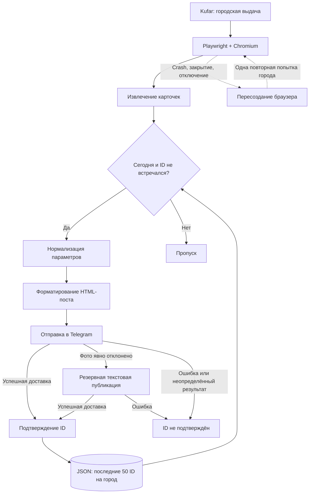

# Realt Bot — Rental Listings Monitor & Telegram Publisher

Realt Bot автоматизирует мониторинг предложений аренды квартир на Kufar, извлекает структурированные параметры и публикует новые объявления в Telegram-каналах шести городов Беларуси: Минска, Гомеля, Могилёва, Витебска, Гродно и Бреста.

Проект показывает практику Web Scraping, Browser Automation, Data Processing и Business Automation на Python: от чтения динамической страницы до подготовки поста и подтверждения доставки. Текущий статус — прототип; проект не является официальным продуктом Kufar или Telegram.

## Пример публикации

Синтетический пример по формату `listing.render_post()`: данные и ссылки вымышлены, подпись показана с демонстрационными адресами каналов. HTML-выделение Telegram передано средствами Markdown; это не снимок реальной публикации.

> ✅ **2-комн. · 54 м²**<br>
> 💰 **1200 BYN/мес.**
>
> **Адрес: ул. Примерная, 10**<br>
> 📍 **Район: Советский**<br>
> **Этаж: 3/9**
>
> 🐈 Животные: **не указано**
>
> 📌 *Светлая квартира. Рядом парк.*
>
> 🔥 **[Объявление на Kufar](https://example.invalid/listings/1001)**
>
> ⌛ Размещено: 14:30
>
> **[МИНСК](https://example.invalid/channels/minsk) | [ГОМЕЛЬ](https://example.invalid/channels/gomel) | [МОГИЛЕВ](https://example.invalid/channels/mogilev) | [ВИТЕБСК](https://example.invalid/channels/vitebsk) | [ГРОДНО](https://example.invalid/channels/grodno) | [БРЕСТ](https://example.invalid/channels/brest)**
>
> \#комнат_2 #1200_1800BYN #район_Советский

Здесь цена источника — `1200 BYN/мес.`, поэтому создаётся тег `#1200_1800BYN`. Неизвестные условия о животных выводятся как «не указано»; отсутствующее метро не добавляется. Правила неполных карточек, ценовых диапазонов и сокращения текста — в [описании публикаций](docs/PUBLISHING.md).

## Основные возможности

- **Мониторинг шести городов:** последовательный обход городских выдач в одном асинхронном цикле.
- **Автоматизация браузера:** Playwright управляет headless Chromium и читает динамическую HTML-разметку.
- **Обработка данных:** извлечение и консервативная нормализация цены BYN за месяц, комнат, площади, этажа, района, метро и явно указанных условий.
- **Оформление:** HTML-посты с выделением блоков, экранированием текста и отдельными лимитами подписи к фото и сообщения.
- **Тематические хештеги:** до трёх тегов по известным комнатности, месячной цене и району.
- **История публикаций:** последние 50 успешно отправленных ID на город в JSON; подтверждение после доставки.
- **Резервный текст:** публикация без фото при его явном отклонении Telegram или нехватке места в подписи.
- **Восстановление Chromium:** пересоздание браузера после обнаруженного сбоя и одна повторная попытка обработки текущего города.

## Архитектура



Проверка ID повторяется перед отправкой; отсутствие фото или слишком короткая подпись сразу ведут к текстовой публикации. Города обрабатываются последовательно, отдельной очереди доставки нет. Подробности и состав модулей — в [архитектуре](docs/ARCHITECTURE.md).

## Инженерные решения

| Решение | Обоснование и реализация |
| --- | --- |
| Асинхронная автоматизация браузера | `asyncio` и Playwright позволяют ожидать загрузку страниц и отправку без блокирующих пауз; обход городов остаётся последовательным. |
| Нормализация и отделение представления | `listing.parameters()` сохраняет неизвестность неоднозначных значений; `render_post()` формирует пост независимо от чтения DOM в `main.py`. Исходные поля остаются в памяти. |
| Ограниченная история и подтверждение доставки | `deque(maxlen=50)` ограничивает объём JSON; ID записывается после успеха Telegram. Это сокращает повторы, но не обеспечивает доставку без дубликатов. |
| Резервный текст и восстановление браузера | `send_to_telegram()` обрабатывает отказ фото, `BrowserSession` пересоздаёт Chromium после обнаруженной аварии; число попыток города ограничено. |
| Безопасный HTML и лимиты | Поля экранируются, длина оценивается в UTF-16 после разбора HTML; подпись и текст собираются с разными бюджетами. |
| Изолированные проверки и CI | `unittest` использует локальный HTML, временные файлы и подмену Telegram; GitHub Actions задаёт матрицу Windows/Linux × Python 3.12/3.13. |

## Технологический стек

Python **3.12+**, asyncio, Playwright, Chromium, aiogram, Loguru, python-dotenv, unittest, Ruff, uv и GitHub Actions. Файл `.python-version` выбирает **Python 3.13**, версии зависимостей зафиксированы в `uv.lock`.

## Быстрый старт

Нужны Git и [uv](https://docs.astral.sh/uv/getting-started/installation/). Из нового рабочего каталога:

```bash
git clone https://github.com/partizan-code/realt-bot.git
cd realt-bot
uv sync --locked
uv run --locked playwright install chromium
```

Скопируйте `.env.example` в `.env` в корне проекта. Шаблон содержит комментарии: добавьте активные присваивания `TOKEN=...`, `ADMIN_ID=...` и шесть `*_CH_ID=...` со своими значениями. Все ID должны быть целыми числами.

Добавьте бота в каналы с правом публикации и проверьте ссылки `SIGNATURE` в `config.py`. Для первого запуска настройте тестовые каналы. Необязательный файл сессии должен иметь формат Playwright `storage_state`; обычный экспорт списка cookies ему не равнозначен.

Запуск из корня проекта выполняет реальные публикации в каналы из окружения:

```bash
uv run --locked python main.py
```

Остановка — `Ctrl+C`. [Подробная настройка](docs/SETUP.md) включает все переменные, особенности Windows/macOS/Linux и работу с сессией браузера.

## Тестирование

После установки зависимостей и Chromium:

```bash
uv run --locked ruff check .
uv run --locked ruff format --check .
uv run --locked python -m unittest discover -s tests -v
```

Тесты проверяют конфигурацию, локальные HTML-примеры, нормализацию, формат поста, лимиты, подтверждение ID, резервную отправку, восстановление браузера и логирование. Telegram подменяется; рабочие каналы и Kufar для этих проверок не нужны.

Workflow [Checks](.github/workflows/checks.yml) настроен на `push` и `pull_request` для `ubuntu-latest` и `windows-latest` с Python 3.12/3.13. Его наличие не подтверждает успешность конкретного прогона. При обновлении этой документации функциональные тесты и CI не запускались. [Методика проверок](docs/TESTING.md).

## Состояние и ограничения

- **Прототип:** актуальность селекторов Kufar и реальная доставка после последних изменений требуют отдельного подтверждения; production-готовность не заявляется.
- Сбор зависит от HTML-разметки Kufar. Обрабатываются доступные карточки с отметкой **«Сегодня»**; полнота сбора и получение сведений из полных страниц объявлений не гарантируются.
- История ограничена последними **50 ID на город**. Вытеснение ID, повреждение истории, параллельные запуски и неопределённый сетевой результат могут привести к повторам; гарантии доставки без дубликатов нет.
- Постоянного архива объявлений нет. **SQLite-архив и регулярная аналитика запланированы**, как и расписание сводок: [план развития](docs/ROADMAP.md).
- `scripts/deploy.sh` и `realt-bot.service` — заготовки Linux-деплоя, требующие адаптации и проверки; подтверждённого автоматического развёртывания нет.

## Документация и участие

[Навигация по документации](docs/README.md): настройка, архитектура, публикации, проверки и эксплуатация. Текущее состояние работ — [PROJECT_STATUS.md](docs/PROJECT_STATUS.md), план — [ROADMAP.md](docs/ROADMAP.md), правила работы с проектом — [AGENTS.md](AGENTS.md).

В issues и pull request прикладывайте обезличенные ошибки с версией Python и ОС; для проблем парсинга — синтетический или обезличенный HTML-пример. `.env`, cookies, журналы, история ID и диагностические материалы исключаются из Git. Не публикуйте токены, содержимое сессий и личные данные.

## Лицензия

Файл `LICENSE` не добавлен. Условия использования и распространения кода ещё не определены.
